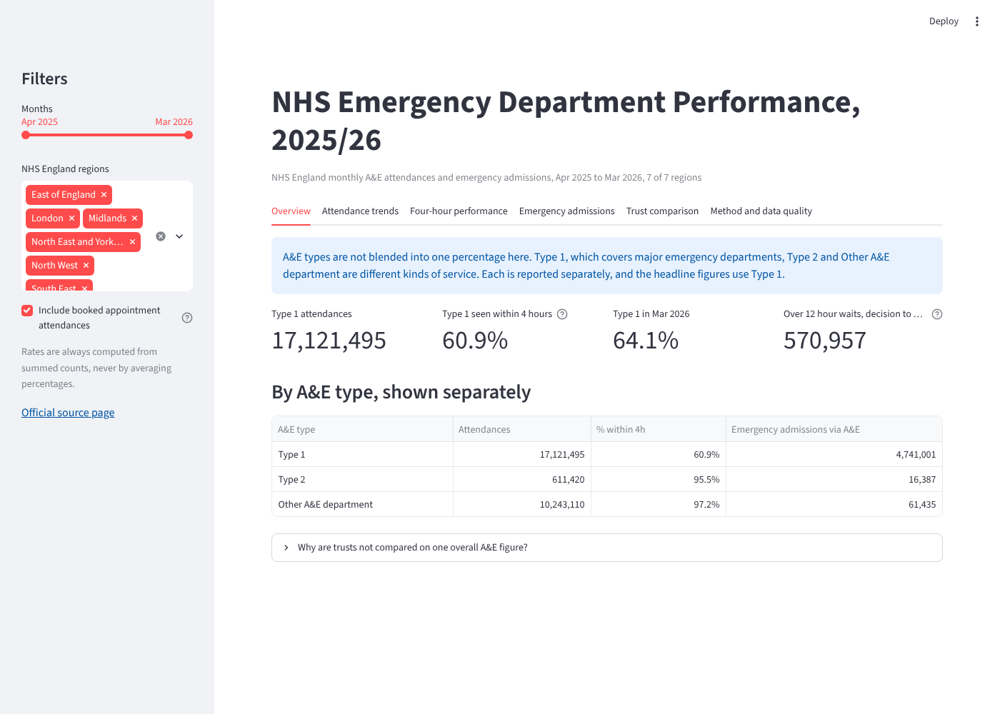
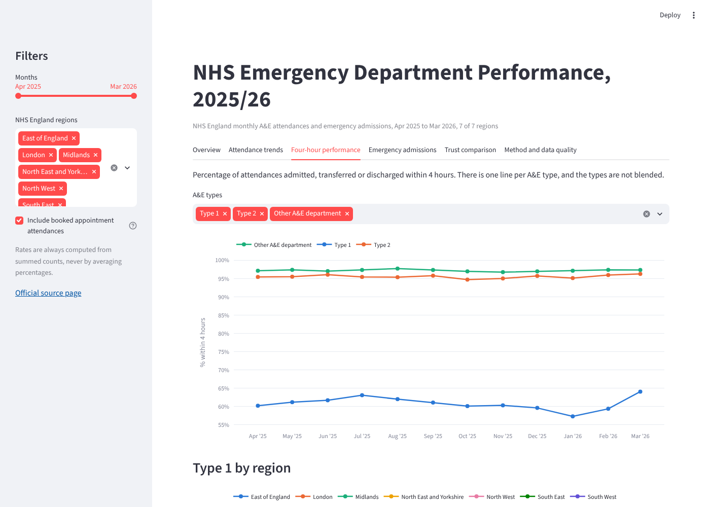
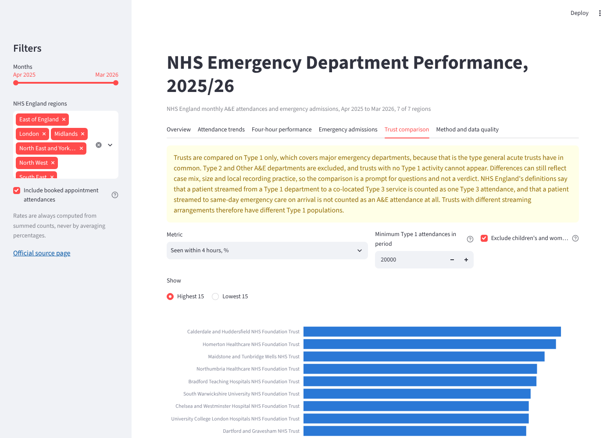

# NHS Emergency Department Performance, 2025/26

An analysis of NHS England's monthly A&E attendances and emergency admissions from April 2025 to March 2026. The data are cleaned and checked with Python and pandas, stored in SQLite, queried with SQL and explored in a Streamlit dashboard. The results are compared with the figures NHS England published.



## Data

The data come from [A&E Attendances and Emergency Admissions 2025-26](https://www.england.nhs.uk/statistics/statistical-work-areas/ae-waiting-times-and-activity/ae-attendances-and-emergency-admissions-2025-26/), published by NHS England. They consist of twelve monthly provider-level CSV files with 2,386 organisation-month rows. The project asks how attendances, four-hour performance, emergency admissions and long waits changed over the year, and how regions and trusts compare on Type 1 departments, which are the major emergency departments.

## Main findings

These describe the reported data. The project has no information on case mix, staffing or capacity, so it does not explain the differences. Full figures are in [docs/FINDINGS.md](docs/FINDINGS.md).

- Type 1 departments recorded 17.1 million attendances, and 60.9% of them were seen within four hours. Monthly performance ranged from 57.3% in January 2026 to 64.1% in March 2026. The rise of 4.7 points into March 2026 was the largest monthly change.
- By region, Type 1 performance ran from 63.8% in the South East to 57.7% in the North West and South West.
- Across 118 trusts, excluding children's and women's hospitals, Type 1 performance ranged from 43.6% to 83.4%, with a median of 60.0%.
- 570,957 patients waited more than 12 hours from decision to admit, and the peak was 71,517 in January 2026.
- Pooling all department types raises each region's figure by 12 to 15 points, because the other types report about 95 to 98% a month against about 61% for Type 1. Regions and trusts are therefore compared on Type 1 only.
- Admissions per 100 Type 1 attendances range from 8.9 to 57.0 between trusts. A spread this wide probably reflects local recording and pathways, so the ratio is not used as a measure of quality.

## Dashboard

The dashboard has six tabs: overview, attendance trends, four-hour performance, emergency admissions, trust comparison, and method and data quality. The filters cover the month range, the region and whether booked appointments are included.

| Four-hour performance | Trust comparison |
|---|---|
|  |  |

## Running it

This needs Python 3.12 or later.

```bash
git clone https://github.com/Abrarzahran/nhs-emergency-department-analytics.git
cd nhs-emergency-department-analytics
python -m venv .venv
source .venv/bin/activate        # Windows: .venv\Scripts\activate
pip install -r requirements.txt

python scripts/build_database.py   # clean, validate and load the data into SQLite
python -m pytest                   # runs the 78 tests
python scripts/run_queries.py      # runs the 10 SQL analyses in sql/queries/
streamlit run app/streamlit_app.py
```

The dashboard builds the database itself if it is missing, but `run_queries.py` needs it built first. The build stops if a file header changes or a validation check fails. The main check is that the organisation rows add up exactly to NHS England's own TOTAL row for every column and month. The tests also compare the results with figures from NHS England's published commentary. The reasons for the main design choices are in [docs/DECISIONS.md](docs/DECISIONS.md).

## Deployment

The SQLite database is generated from the CSV files in `data/raw` and is not committed to the repository. When the dashboard starts and the database file is missing, it builds the file itself, which takes a few seconds, and caches the result for the life of the server process. Running `python scripts/build_database.py` first is therefore optional for the dashboard.

On Streamlit Community Cloud, create the app from this repository with `app/streamlit_app.py` as the main file and Python 3.12 or 3.13. The dependencies come from `requirements.txt`. If the app shows an error about failed validation checks, running the build script locally prints the details.

## Method notes and limitations

- Booked appointments: the four-hour percentage includes booked appointment attendances, which reproduces NHS England's published Type 1 figure in all 8 months checked. NHS England's definitions document, version 5.0 from August 2020, defines the counts but not the percentage, so this choice rests on that match. A sidebar option excludes booked appointments. For East Sussex the choice changes the trust-level result by 7.5 points.
- Department types: Type 1, Type 2 and Other A&E department, which is Type 3, are reported separately and never pooled in comparisons.
- Streaming: under NHS England's definitions, patients streamed from a Type 1 department to a co-located Type 3 service count as Type 3 attendances, and patients streamed to same-day emergency care on arrival are not counted. Trusts with different arrangements therefore have different Type 1 populations.
- Waits: decision-to-admit waits run from the decision to admit, or the end of A&E treatment if later, until admission. They are shown as counts, not rates.
- Revised files: NHS England has revised some monthly files, including October 2025, December 2025 and March 2026. The only differences found against the original commentaries fall in those months and are at most 0.2% of attendances. The cause and the revision dates are not confirmed, as set out in [docs/REVISIONS.md](docs/REVISIONS.md).
- Scope: one year of monthly data, no confidence intervals, and the children's and women's flag is based on the trust name.

The checks against the official definitions are in [docs/DEFINITIONS_CROSSWALK.md](docs/DEFINITIONS_CROSSWALK.md), and the column definitions are in [docs/DATA_DICTIONARY.md](docs/DATA_DICTIONARY.md).

## Licences and sources

- The NHS England data are used under the [Open Government Licence v3.0](https://www.nationalarchives.gov.uk/doc/open-government-licence/version/3/). Contains public sector information licensed under the Open Government Licence v3.0. NHS England's [terms and conditions](https://www.england.nhs.uk/terms-and-conditions-2/) allow re-use of website information on that basis, excluding logos, photographs and third-party content. See [NOTICE.md](NOTICE.md) and [data/README.md](data/README.md).
- The original code, SQL, tests and documentation are released under the [MIT licence](LICENSE), copyright 2026 Abrar Zahran. The MIT licence does not cover the NHS England data.
- The definitions used are in NHS England's [A&E Attendances and Emergency Admissions Monthly Return Definitions](https://www.england.nhs.uk/statistics/statistical-work-areas/ae-waiting-times-and-activity/), version 5.0, August 2020.
- This is an independent project. It has not been produced, reviewed or endorsed by NHS England.

## AI assistance

Anthropic’s Claude was used to assist with writing code, running tests and identifying errors.
